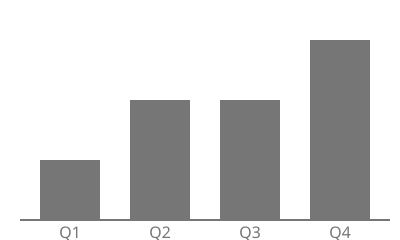

# Summary {#sec-summary}

## Results

::: {.callout-note}

One key, `extensions: mcanouil: preset:`, sets the colours, the fonts, the style and the motif.

:::

| Measure      | Value |
|--------------|------:|
| Pages        |    42 |
| Contributors |     5 |
| Releases     |     3 |

: Main figures of the quarter. {#tbl-results}

## Trend

{#fig-trend fig-alt="A bar chart with four bars that grow from one release in the first quarter to three releases in the fourth quarter." width="60%"}

@fig-trend shows the releases per quarter.

## Quote

> Design for the reader who cannot see the colours.
>
> -- Mickaël Canouil, 2026

# Next steps {#sec-next}

## Code

```{.r filename="summary.R"}
releases <- c(1, 2, 2, 3)
mean(releases) |> round(digits = 1)
```

## Follow-up

- Review @tbl-results each quarter.
- Keep the numbers in @sec-summary up to date.
