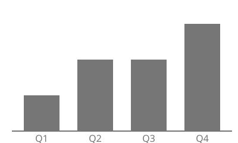

# Results

{#fig-body fig-alt="A bar chart with four bars that grow from one release in the first quarter to three releases in the fourth quarter." width="50%"}

@fig-body shows the releases. @sec-extra gives the data sources, and @tbl-supp lists the patients by arm.

# Extra analyses {.appendix #sec-extra}

The analyses that support the results.

## Data sources

The data come from the release notes of each version.

$$
y = a x + b
$$ {#eq-apx alt="y equals a x plus b."}

# Supplementary material {.supplementary}

The material that did not fit in the article.

| Arm     | Patients |
|---------|---------:|
| Placebo |       40 |
| Active  |       42 |

: Patients by arm. {#tbl-supp}
