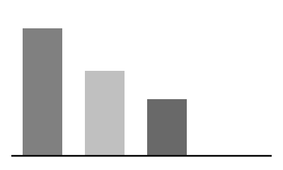

# Brand presets

## Why presets?

- One source of truth for colour and type.
- Contrast checked at render time.
- Same look in PDF, HTML and slides.

## Contrast at a glance

:::: {.columns}

::: {.column width="50%"}

- Text pairs at 4.5:1 or more.
- Rules and edges at 3:1 or more.

:::

::: {.column width="50%"}

{fig-alt="Bar chart of the contrast ratio of three colour pairs."}

:::

::::

## Pick a preset

```{.yaml filename="_brand.yml"}
extensions:
  mcanouil:
    preset: gold # <1>
```

1. One key selects the preset for every format.

# Checks

Sources at [github.com/mcanouil](https://github.com/mcanouil).

## One rule

::: {.callout-important}
Decoration never sits under text.
:::

> Design for the reader who cannot see the colours.
>
> -- Mickaël Canouil, 2026

## Why presets, after dark {.dark}

- The dark slide takes the dark tokens of the preset.
- Links stay readable: [mickael.canouil.fr](https://mickael.canouil.fr).
